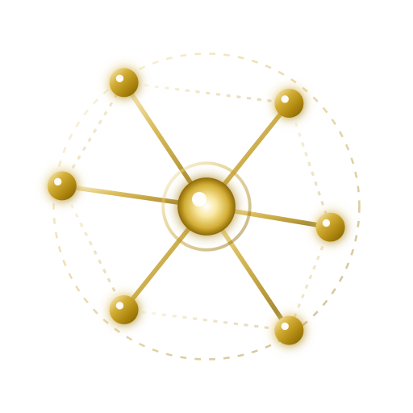

   
  

  # Abdul Rohman Masrifan (Mabot)
  
  
<strong>Programmer yang hobi membaca dan menulis realitas.</strong>

  
<em>"Membaca realitas dengan akal. Menyelaminya dengan rasa. Menuliskannya sebagai perjalanan kesadaran."</em>

  

    
    
    
    
  

---

### ☕ Sekilas Tentang Saya

Halo, saya **Mabot**. Keseharian saya banyak berkutat dengan pemrograman, merancang sistem backend, dan membangun aplikasi. Di luar urusan kode, saya punya hobi sederhana: **membaca dan menulis realitas**. 

Dari kegemaran mengamati fenomena hidup, sains, ketauhidan, dan dinamika kesadaran itulah akhirnya mengalir naskah-naskah catatan yang saya simpan secara terbuka di **[intisatu.com](https://intisatu.com)**.

* 💻 **Dunia Pemrograman**: Senang mengeksplorasi sistem yang efisien dan andal (**Go**, **Rust**, **Python**), aplikasi praktis untuk bisnis nyata (**Point of Sale / ERP Kasir**), serta alur kerja modern berbasis *AI agentic*.
* 📖 **Dunia Baca-Tulis**: Menulis bukan untuk merasa paling tahu atau mengajari orang lain, melainkan sarana pengingat pribadi agar tetap waras, jernih, dan sadar di tengah derasnya arus dunia.
* 🛠️ **Prinsip Kerja**: Belajar terus, tetap membumi, dan membuat karya yang bermanfaat secara nyata.

---

### 🛠️ Proyek & Eksplorasi Santai

Beberapa hal yang sedang atau pernah saya bangun dan oprek:

| Proyek | Deskripsi Singkat | Teknologi |
| :--- | :--- | :--- |
| **[INTISATU](https://intisatu.com)** | Rumah bagi catatan hobi membaca realitas — ikhtiar merawat akal dan rasa tanpa pretensi. | `Python`, `Static Site`, `CSS` |
| **FastFlow Systems** | Eksplorasi infrastruktur backend dan REST API berkecepatan tinggi. | `Golang`, `Rust`, `Docker` |
| **Kasiris & SatuKasir** | Oprekan aplikasi kasir, manajemen transaksi kas/bank, dan stok untuk kebutuhan usaha. | `React`, `Flutter`, `MongoDB` |
| **AR & Vision Tools** | Eksperimen sederhana pemindaian produk dan interaksi objek 3D di ruang nyata. | `WebXR`, `Three.js`, `Python` |

---

### ⚡ Perangkat & Teknologi (Tech Stack)

#### Bahasa Pemrograman

  
  
  
  
  
  

#### Framework & Frontend / Mobile

  
  
  
  
  

#### Basis Data & Alat

  
  
  
  
  

---

### 📊 Statistik GitHub

  
  &nbsp;
  

 

---

### 📬 Kontak & Ngobrol Santai

Kalau ada tanggapan, mau diskusi seputar codingan, atau sekadar berbagi cerita dan kabar:

* ✉️ **Surel**: [mabot@intisatu.com](mailto:mabot@intisatu.com)
* 🌐 **Catatan Tulisan**: [intisatu.com](https://intisatu.com)
* 📸 **Instagram**: [@intisatu](https://instagram.com/intisatu)
* 📍 **Domisili**: Surabaya, Jawa Timur, Indonesia

 

  <i>"Tulisan ini bukan untuk membuatmu pintar atau merasa paling benar, melainkan untuk membantumu mengingat siapa dirimu yang sesungguhnya."</i>

